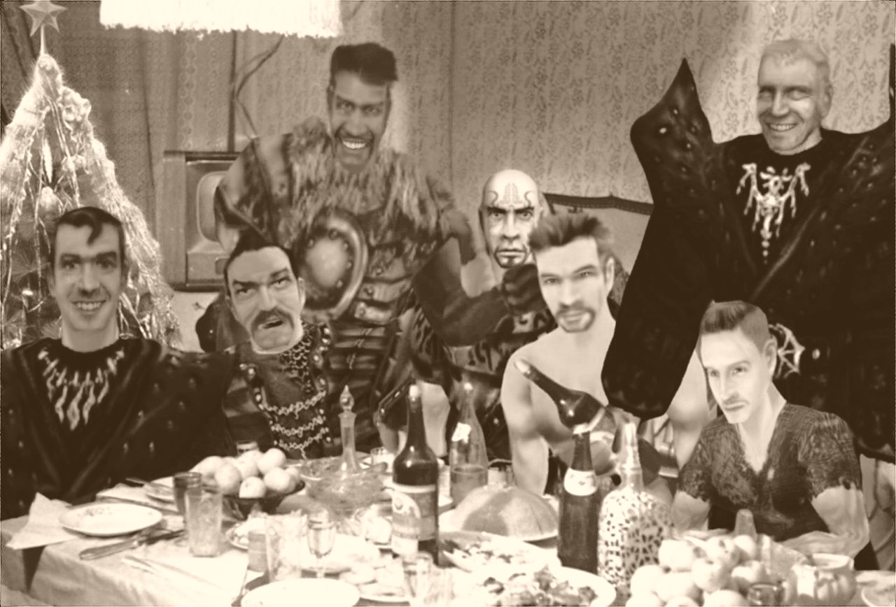

# ianWe

### C++ разработчик · геймдев

*Игры · код · алгоритмы · IT*

---

## Обо мне

Пишу на С++, интересуюсь разработкой игр и программ на вин/лин.

- Основной язык — C++.
- Главное направление — разработка игр(наверно).
- Ещё немного Python, веб.
- Сижу на Linux(пока).
- Основной проект — Dungeon Explorer. Надеюсь сделаю крупнее в будущем.

## Образование

**НовГУ им. Ярослава Мудрого**

- Информатика и вычислительная техника, бакалавриат.
- 2025–2029.

## Навыки

### Языки и веб

- **C++** — основной.
- **Python** — основные основы, ЕГЭ по инфе на нем сдавал.
- **PHP** — основы веба, связь с бд, крч страничку логина пароль сделаю.
- **JavaScript** — учу и практикуюсь в вебе.
- **SQL** — основы баз данных имеются.
- **HTML/CSS** — верстка, любимое раньше.

### Геймдев

- Приложения на C++.
- SFML, QT.
- 2D-игры.
- Игровая логика.
- Процедурная генерация.
- Графы.
- Алгоритмы поиска пути.

### Инженерия

- ООП.
- Алгоритмы и структуры данных.
- Теория графов.
- Проектирование систем.
- Отладка и тесты.

### Инструменты

  
  
  
  
  
  

---

## Главный проект

### Dungeon Explorer

C++17-приложение: процедурная генерация подземелий, графы, визуализация поиска пути.

**Что умеет:**

- Генерирует комнаты процедурно.
- Строит граф связей между комнатами.
- BFS, DFS, Дейкстра.
- Настраиваемые параметры генерации.
- Визуализация обхода графа и пути.
- Автотесты.

**Стек:** C++17 · SFML 3.0.2 · CMake · GoogleTest

**Планы:**

- Adventure Mode. Можно будет играть на сгенерированных подзмельях. Вдохноваляюсь игрой Soul Knight.
- Бои, пушки.
- Интерактивное исследование.
- Больше механик.
- Dungeon Editor режим, где юзер может сам делать граф и искать пути.

[Репозиторий](https://github.com/ArkadiiKabin/project-graph)

---

## Курсы и сертификаты

Stepik.

### Программирование

| Курс | Результат |
|---|---:|
| [«Поколение Python»: для начинающих](https://stepik.org/cert/2615322) | 100% |
| [Войти в IT](https://stepik.org/cert/2652101) | 94% |

### Веб

| Курс | Результат |
|---|---:|
| [HTML CSS JS (lite)](https://stepik.org/cert/2631559) | С отличием |
| [Веб-разработка для начинающих: HTML и CSS](https://stepik.org/cert/2615370) | 100% |
| [Веб-технологии: начальный уровень](https://stepik.org/cert/2615032) | 100% |
| [Основы HTML & CSS](https://stepik.org/cert/2601890) | 100% |

### Цифровая грамотность

| Курс | Результат |
|---|---:|
| [Безопасность в интернете](https://stepik.org/cert/2601910) | 100% |
| [Stepik для учащихся: первые шаги](https://stepik.org/cert/2617630) | 100% |

### Дополнительно

| Курс | Результат |
|---|---:|
| [Разработка мобильных приложений для Android](https://stepik.org/cert/2750248) | С отличием |

---

## Другое

- Выпускной проект — ITC, 2024.
- Landing Page, 2024.
- Интернет-магазин «Юный техник», 2024.
- «Социальная психология» — ИНТУИТ, 2025.

---

## Куда двигаюсь

| Направление | Статус |
|---|---|
| C++ | Основное |
| Game Dev | Практика |
| SFML | Практика |
| Алгоритмы и структуры данных | Учу и практикую |
| Python | Учу и практикую |
| HTML/CSS | Основы |
| JavaScript | Учу |
| Desktop | В процессе |
| 2D Action-Adventure | В планах |
| 8-bit игры | В планах |
| Архитектура ПО | Углубляю |

---

## GitHub

## Активность

---

## Контакты

- GitHub: [@ArkadiiKabin](https://github.com/ArkadiiKabin)
- Telegram: [@almostawakex](https://t.me/almostawakex)
